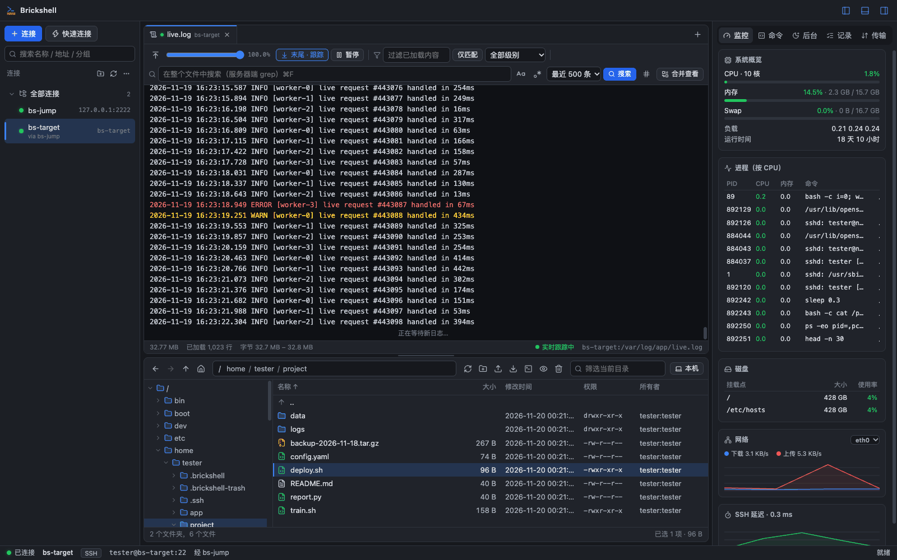
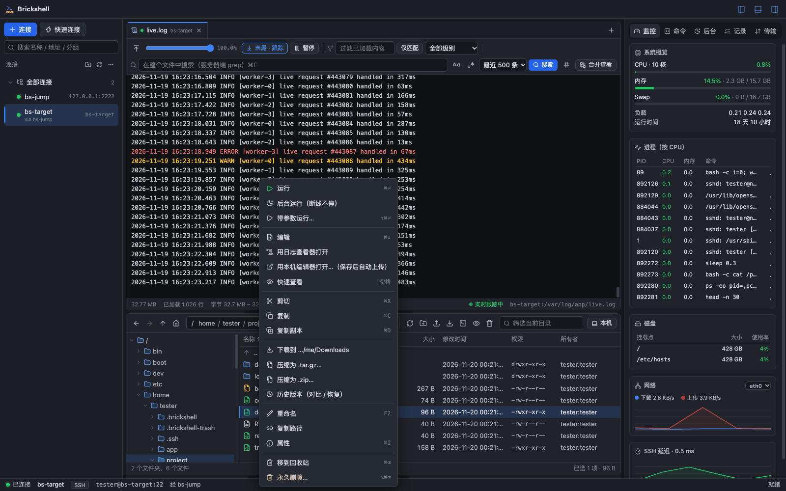
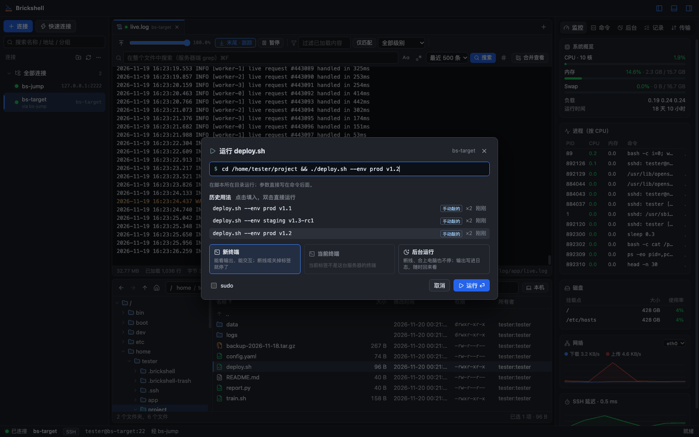
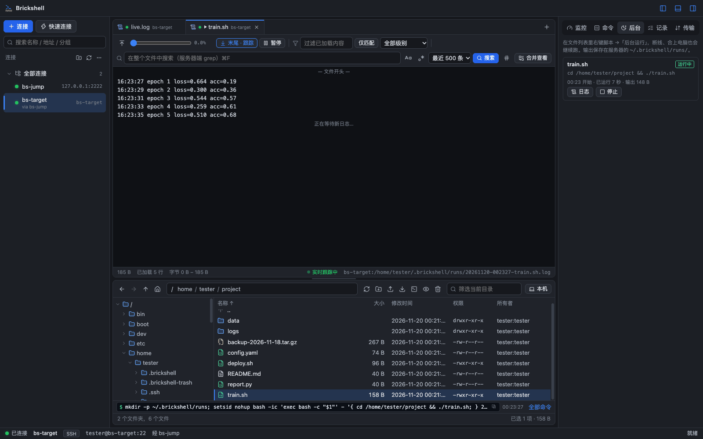
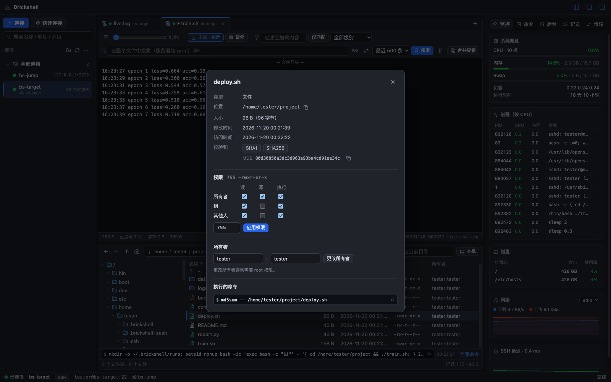

# Brickshell

**像用自己的电脑一样用 Linux 服务器。**

连上服务器以后，浏览文件、编辑、上传下载、运行脚本、查看日志，都和在 Finder / 资源管理器里一样用鼠标完成；
每一步在服务器上实际执行的命令都会显示出来，用着用着就学会了 Linux。

**[⬇ 下载最新版](../../releases/latest)** · macOS（Apple Silicon / Intel）· Windows 10 / 11



---

## 为什么用 Brickshell

- **更容易上手** —— 学会连上服务器就够了。复制粘贴、拖拽、重命名、双击编辑、右键运行，
  都是你在 Mac 和 Windows 上早已熟悉的操作，不需要先背命令、学 vim。
- **零成本迁移** —— 已有的 `~/.ssh/config`、密钥、跳板机直接能用；服务器上什么都不用装，
  能用 SSH 登录就行。习惯命令行的人也一样顺手：终端、分屏、命令片段、历史记录都在。
- **在使用中学会 Linux** —— 每一个图形操作都会显示它对应的命令（`cp -a`、`mv`、`tar czf`、
  `chmod 755`、`nohup` …）。先用鼠标把事做完，再看懂背后的命令；命令记不清的时候，照着用就行。
- **不怕误操作** —— 删除先进回收站，可以撤销；保存文件前自动备份，随时对比、恢复旧版本；
  没有权限时会说清楚是谁的文件、为什么不能改、该怎么办。

## 功能

**连接**
- 自动读取 `~/.ssh/config`（支持 `Include`、`Match`、跳板机 `ProxyJump`、`ProxyCommand`），也可以在界面里添加、分组、导入导出
- 密码、密钥（含 PuTTY `.ppk`）、证书登录；密码保存在 macOS 钥匙串 / Windows 凭据管理器，不写入任何配置文件
- 网络断开、电脑睡眠后自动重连，终端和日志接着用；打开的标签下次启动自动恢复

**文件**
- 像 Finder / 资源管理器一样操作：⌘C ⌘V（Windows 用 Ctrl）、拖拽移动、F2 重命名、空格快速查看、⌘I 属性
- 服务器内复制移动直接在服务器上完成，跨服务器复制粘贴也行
- 本机和服务器双栏对照，拖过去就是上传下载；传输队列支持断点续传，重启后继续
- 回收站：误删可撤销，7 天后自动清理
- 压缩 / 解压（tar.gz、zip 等）、文件夹大小、MD5 / SHA 校验和、权限（勾选框或数字）、所有者

**编辑**
- 双击即可编辑，保存前自动备份，「历史版本」里对比差异、一键恢复
- 也可以用本机的 VS Code / Cursor / Sublime 等打开，保存后自动上传
- 保持文件原有的换行符（Windows 的 CRLF 不会被改掉）；保存别人的文件不会改变它的所有者

**运行脚本**
- 右键 `.sh` / `.py` 等脚本 →「运行」，在新终端里执行，能看输出、能交互
- 「带参数运行」：列出以前用过的参数（包括你在终端里手敲过的），点一下填入、改一改再运行
- 「后台运行」：适合要跑很久的任务，**断网、合上电脑也不会停**；右侧「后台」面板查看进度、日志、停止

**日志**
- 几 GB 的日志也能秒开，实时跟踪新内容
- 在服务器上直接搜索整个文件（只传回匹配的行），按 ERROR / WARN 等级别过滤
- 多个日志（可以在不同服务器上）按时间合并成一条时间线查看
- 日志被轮转、清空后自动接上，不丢行

**终端与命令**
- 多标签、左右 / 上下 / 网格分屏，「同步输入」同时操作多台服务器
- 常用命令存成片段，支持参数；所有执行过的命令都有历史记录，可以搜索
- 粘贴保护：粘贴多行命令前先确认，避免误执行

**监控**
- CPU、内存、磁盘、网络、SSH 延迟，进程列表（可结束进程）

## 截图

**右键菜单：脚本可以直接运行或后台运行**



**带参数运行：历史参数一键复用，选择在哪里运行**



**后台运行：断线不停，随时回来看日志**



**属性：权限勾选即改，下方显示实际执行的命令**



## 下载安装

到 [Releases](../../releases/latest) 下载对应系统的安装包。

### macOS

1. 下载 `Brickshell-macos.dmg`，双击打开，把 Brickshell 拖到「应用程序」文件夹。
2. 第一次打开时，macOS 会提示“无法验证开发者”。二选一：
   - 先双击打开一次（会被拦下），然后到 **系统设置 → 隐私与安全性**，在页面下方找到 Brickshell，点 **仍要打开**；
   - 或在「终端」里执行：
     ```sh
     xattr -dr com.apple.quarantine /Applications/Brickshell.app
     ```
   之后就不会再提示了。

需要 macOS 11 或更新版本，Apple Silicon 和 Intel 芯片通用。

### Windows

1. 下载 `Brickshell-windows-x64.zip`，解压到任意文件夹（例如 `D:\Brickshell`）。
2. 双击 `Brickshell.exe`。如果出现 SmartScreen 提示“Windows 已保护你的电脑”，点 **更多信息 → 仍要运行**。

需要 Windows 10 / 11（64 位）。

### 校验下载（可选）

Release 中附带 `SHA256SUMS.txt`，可以核对下载的文件是否完整：

```sh
shasum -a 256 Brickshell-macos.dmg          # macOS
certutil -hashfile Brickshell-windows-x64.zip SHA256   # Windows
```

## 快速开始

1. 点左上角 **连接**，填写服务器地址、用户名和密码（或选择密钥）。
   如果你的 `~/.ssh/config` 里已经配置过服务器，它们会直接出现在左侧列表里，点一下就能连。
2. 连上后，下方是服务器的文件列表：双击文件夹进入，双击文件编辑，右键看更多操作。
3. 想用命令行？点文件列表上方的终端按钮，在当前文件夹打开终端。
4. 想看某个操作对应的命令？看文件列表下方那一行，或右侧「记录」里的全部历史。

## 常见问题

**需要在服务器上安装什么吗？**
不需要。只要能用 SSH 登录的 Linux 服务器就可以。

**我的数据保存在哪里？**
都在你自己的电脑上：配置、命令历史、文件备份在 `~/.brickshell`（Windows 是 `C:\Users\你的用户名\.brickshell`）；
密码在系统钥匙串 / 凭据管理器里。Brickshell 不会修改你的 `~/.ssh/config`。
它只连接你配置的服务器，不收集、不上传任何使用数据。

**删错了文件怎么办？**
默认删除会移到服务器上的回收站（你主目录下的 `.brickshell-trash`），在提示里点「撤销」，或点文件列表上方的回收站按钮找回。
回收站里的文件 7 天后自动清理。选择「永久删除」的文件无法恢复。

**改错了文件怎么办？**
每次保存前都会在你的电脑上备份上一版。在编辑器或右键菜单里打开「历史版本」，对比差异，一键恢复。

**我没有 root 权限，能用吗？**
能。普通账号能做的事都可以做；遇到没有权限的文件，会提示它属于谁、你登录的是谁、该怎么办
（例如在终端里用 `sudo`，或请管理员处理）。

**后台运行的任务，关掉 Brickshell 还会继续吗？**
会。任务在服务器上运行，和 Brickshell 是否打开、网络是否断开无关。输出保存在服务器的 `~/.brickshell/runs/`，
下次打开右侧「后台」面板就能看到结果。注意：后台任务不能等待你输入（比如回答 y/n），需要输入的请用「新终端」运行。

**支持 Linux 桌面吗？**
目前提供 macOS 和 Windows 版本。被连接的服务器可以是任何 Linux 发行版。

## 反馈

遇到问题或有建议，欢迎在本仓库的 [Issues](../../issues) 里提出。
